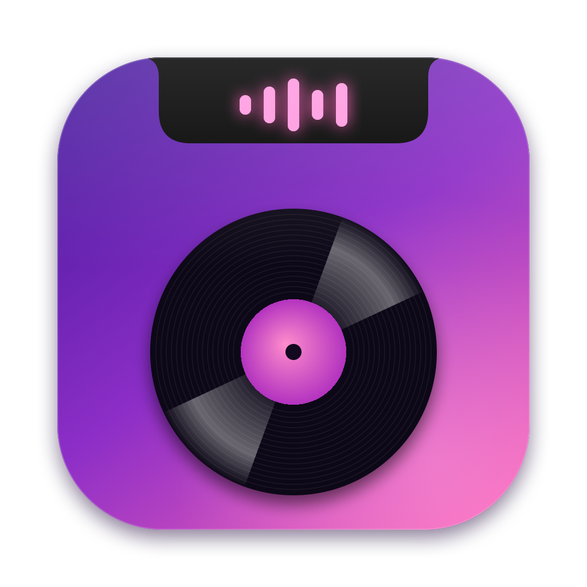
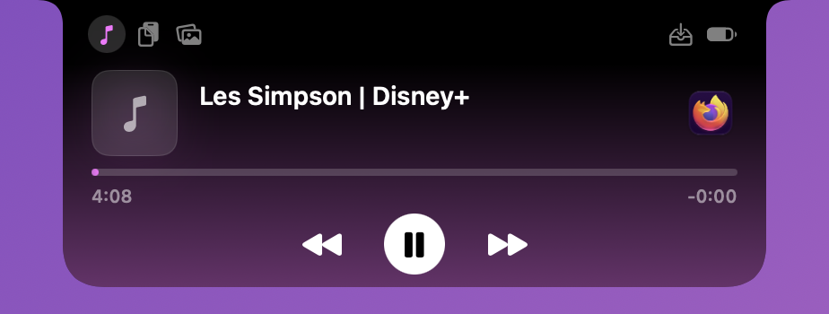
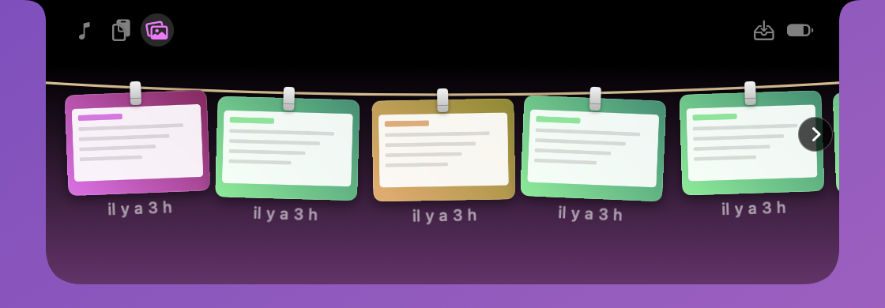
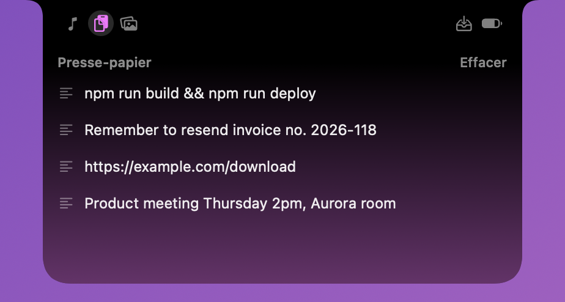
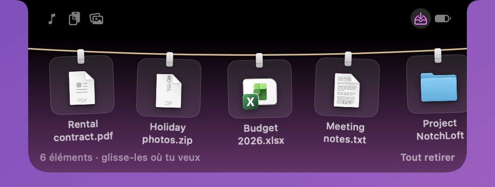
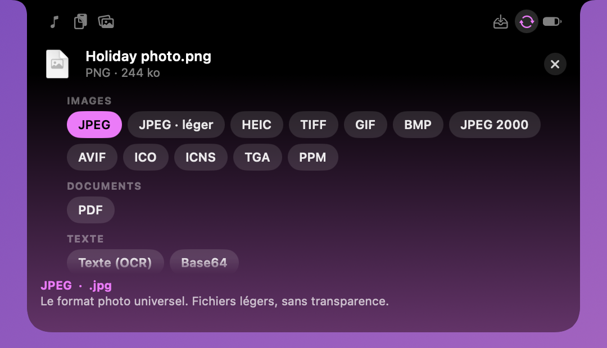
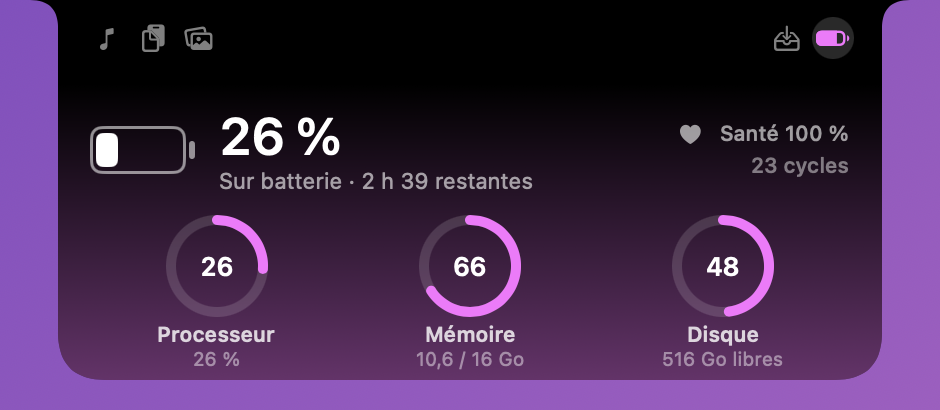

**[English](README.md) · Français**

# NotchLoft

**La boîte à outils cachée dans l'encoche de ton MacBook.**

Musique en cours, presse-papier, étendoir à captures, dépôt de fichiers, convertisseur de fichiers, batterie et système : survole l'encoche, tout est là.

 

Musique

Étendoir à captures d'écran

Presse-papier

Dépôt de fichiers

Convertisseur de fichiers

Batterie et système

 

Au repos

## Fonctionnalités

### 🎵 Musique
- Lit le « Now Playing » du système : Apple Music, Spotify, ton navigateur…
- **Au repos**, l'encoche s'élargit juste un peu : pochette à gauche (avec une bague de progression), visualiseur animé à droite (les barres suivent le son, graves à gauche et aigus à droite), symbole pause en pause. Rien ne s'affiche quand rien ne joue.
- **Au survol** : pochette, titre et artiste (qui défilent s'ils sont longs), barre de progression à cliquer ou glisser, temps écoulé et restant, précédent / lecture-pause / suivant. Un clic sur l'icône de l'app ouvre Spotify, Musique…
- Couleurs d'accent tirées de la pochette, ou teintes fixes au choix.

### 📋 Presse-papier
- Historique du texte copié (30 éléments), un clic remet l'élément dans le presse-papier.
- Épingle les éléments importants : ils restent, même après un redémarrage.
- Les copies de mots de passe (1Password et autres gestionnaires) ne sont jamais enregistrées.

### 🧷 Étendoir à captures d'écran
- Tes dernières captures (jusqu'à 30) s'accrochent à une corde à linge, avec leurs pinces. Fais défiler à gauche ou à droite pour voir les autres.
- **Tout y passe** : captures d'écran, **enregistrements d'écran** (avec leur durée), et captures copiées dans le presse-papiers (⌃⇧⌘3 / ⌃⇧⌘4).
- **Animation** : à chaque nouvelle capture, la miniature s'envole vers l'encoche, qui s'ouvre un instant pour l'accrocher.
- Clic pour ouvrir, **glisse-dépose** vers n'importe quelle app, **croix** au survol pour retirer une capture de l'étendoir (le fichier reste intact), clic droit pour copier, afficher dans le Finder ou mettre à la corbeille.

### 📥 Dépôt de fichiers
- Glisse un fichier ou un dossier sur l'encoche : elle s'ouvre toute seule et il s'accroche à la corde à linge.
- Reprends-le plus tard par glisser-déposer vers n'importe quelle app. Rien n'est copié ni déplacé, ce sont des raccourcis vers tes fichiers.
- Clic pour ouvrir, croix pour retirer, clic droit pour l'afficher dans le Finder ou copier son chemin.

### 🔄 Convertisseur de fichiers
- Dépose un fichier (ou plusieurs) sur l'encoche, choisis le format voulu, c'est fait : le résultat arrive à côté de l'original, sans jamais rien écraser.
- **Survole un format pour savoir ce que c'est** (qualité, poids, compatibilité) avant de choisir.
- **Images** (PNG, JPEG, HEIC, TIFF, GIF, BMP, JPEG 2000, AVIF, WebP*, ICO, ICNS…) → autres images, PDF, ou texte (OCR). Les RAW d'appareil photo et les PSD se lisent aussi.
- **PDF** → une image par page, texte, ou OCR pour les scans ; plusieurs PDF peuvent être fusionnés.
- **Audio** (WAV, AIFF, MP3, M4A, FLAC, OGG…) → M4A, M4A sans perte, WAV, AIFF, CAF, FLAC, AAC (+ MP3, OPUS, OGG, WMA, AC3 avec ffmpeg).
- **Vidéo** (MP4, MOV, MKV, AVI, WebM…) → MP4 1080p / 720p / 480p, HEVC, MOV, M4V, GIF animé, une image en PNG/JPEG, ou juste le son (+ MKV, AVI, WebM, WMV, FLV, MPEG-2 avec ffmpeg). Un GIF animé peut devenir un MP4.
- **Documents** (DOCX, DOC, ODT, RTF, HTML, TXT, Markdown…) → entre eux, plus PDF ; le Markdown est mis en forme en HTML.
- **Données** (JSON, plist, CSV, TSV) → entre elles, plus YAML, tableaux Markdown ou HTML.
- **Archives et dossiers** → ZIP, TAR, TAR.GZ, TAR.BZ2, ou extraction ; encodage/décodage Base64 pour tout fichier.
- Quand tu glisses un fichier vers l'encoche, deux zones apparaissent : **l'accrocher au dépôt** ou **le convertir**. Tout se fait sur ton Mac, rien n'est envoyé en ligne.
- *Des formats en plus (MP3, OGG, OPUS, WebM, MKV, sortie WebP…) apparaissent automatiquement si [ffmpeg](https://ffmpeg.org) est installé (`brew install ffmpeg`).

### 🔋 Batterie et système
- Niveau, état de charge, temps restant, santé et cycles de la batterie, plus processeur, mémoire et disque.
- **Tu choisis ce qui s'affiche en grand** : clique sur une jauge pour la mettre en avant (ou utilise le menu ♪). Le processeur y ajoute sa courbe en direct.

### Et aussi
- **Onglets** dans les ailes de l'encoche pour passer d'un outil à l'autre.
- **Anglais ou français** : l'interface est en anglais par défaut ; passe en français dans le menu ♪ → Langue.
- **Personnalisable** depuis l'icône de la barre des menus : page à l'ouverture (par défaut ou la dernière utilisée), activer ou non chaque outil, visualiseur, bague de progression, fond flou, retour haptique, couleur d'accent, largeur au repos, masquage après une pause, lancement au démarrage, vérification des mises à jour.
- **Discret** : aucune icône dans le Dock, et l'encoche se masque au repos dans les apps en plein écran (elle s'ouvre toujours quand tu survoles l'encoche). Réglable dans le menu ♪.
- **Pour tous les Mac** : sur un Mac sans encoche, une encoche simulée prend le relais.

## Installation

1. Télécharge **NotchLoft.dmg** avec le bouton ci-dessus.
2. Ouvre le DMG et glisse **NotchLoft** dans **Applications**.
3. Au premier lancement, macOS affiche un avertissement car l'app n'est pas notarisée. Ouvre **Réglages Système → Confidentialité et sécurité**, descends jusqu'à NotchLoft et clique sur **Ouvrir quand même**.
4. Pour l'étendoir, autorise l'accès au dossier des captures (Bureau par défaut) quand macOS te le demande.

## Limites

- Le presse-papier ne garde que le texte, pas les images ni les fichiers.
- L'étendoir ne voit pas les captures envoyées directement vers une app (Mail, Messages…) : elles n'existent ni en fichier ni dans le presse-papiers.
- Le visualiseur suit le son du Mac quand tu l'autorises (macOS 14.2 ou plus) ; sans autorisation, il reste une animation décorative. Il ne voit pas le son protégé par DRM.
- L'app n'est pas notarisée par Apple, d'où l'avertissement au premier lancement.
- Les informations de lecture dépendent de ce que l'app transmet au système : certains lecteurs n'envoient ni pochette ni durée.
- Usage personnel uniquement, voir la [licence](LICENSE).
