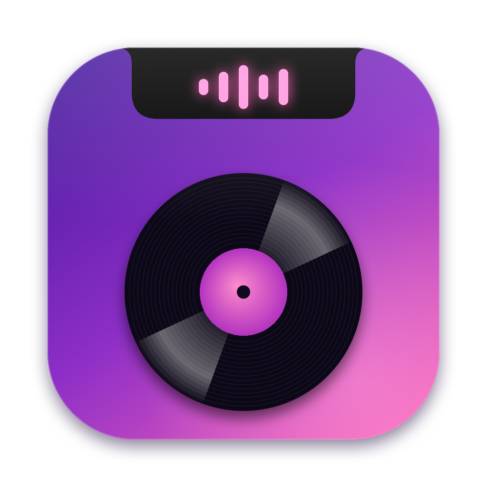
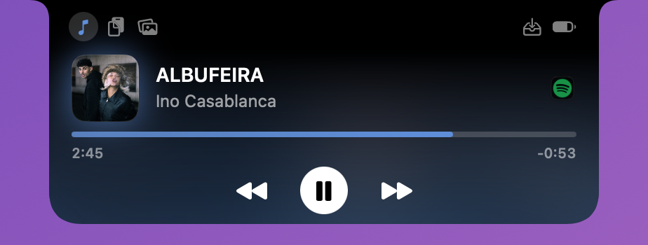
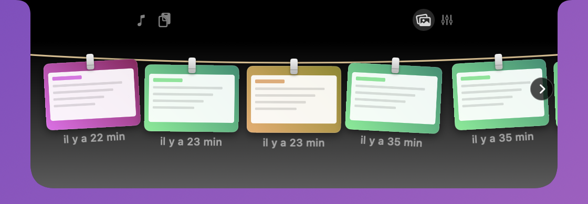
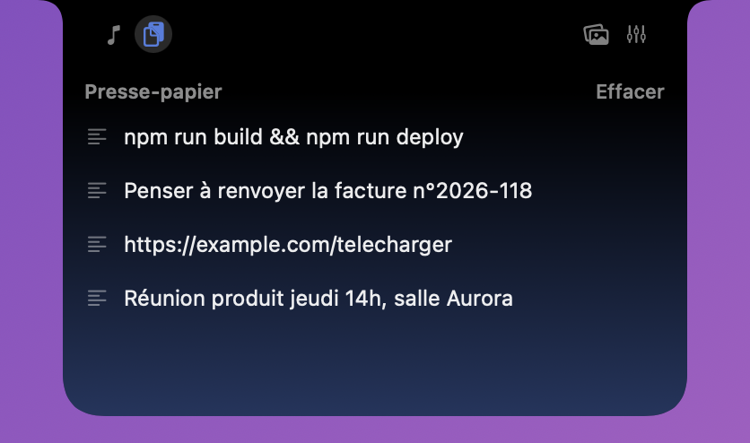
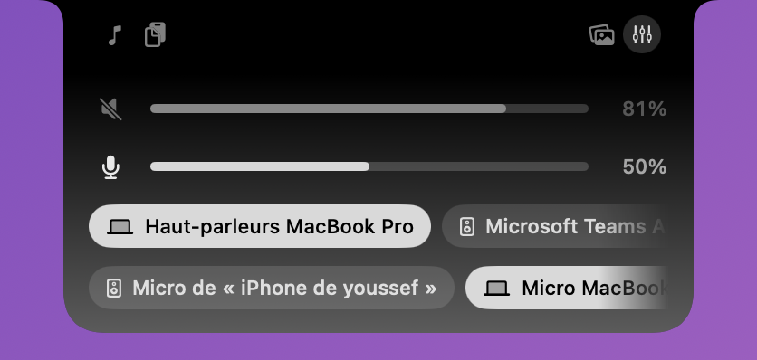

# NotchLoft

**La boîte à outils cachée dans l'encoche de ton MacBook.**

Musique en cours, presse-papier, étendoir à captures d'écran, mixeur audio : survole l'encoche, tout est là.

 

Musique

Étendoir à captures d'écran

Presse-papier

Mixeur audio

 

Au repos

## Fonctionnalités

### 🎵 Musique
- Lit le « Now Playing » du système : Apple Music, Spotify, ton navigateur…
- **Au repos**, l'encoche s'élargit juste un peu : pochette à gauche (avec une bague de progression), visualiseur animé à droite, symbole pause en pause. Rien ne s'affiche quand rien ne joue.
- **Au survol** : pochette, titre et artiste (qui défilent s'ils sont longs), barre de progression à cliquer ou glisser, temps écoulé et restant, précédent / lecture-pause / suivant. Un clic sur l'icône de l'app ouvre Spotify, Musique…
- Couleurs d'accent tirées de la pochette, ou teintes fixes au choix.

### 📋 Presse-papier
- Historique du texte copié (30 éléments), un clic remet l'élément dans le presse-papier.
- Épingle les éléments importants : ils restent, même après un redémarrage.
- Les copies de mots de passe (1Password et autres gestionnaires) ne sont jamais enregistrées.

### 🧷 Étendoir à captures d'écran
- Tes dernières captures (jusqu'à 30) s'accrochent à une corde à linge, avec leurs pinces. Fais défiler à gauche ou à droite pour voir les autres.
- **Tout y passe** : captures d'écran, **enregistrements d'écran** (avec leur durée), et captures copiées dans le presse-papiers (⌃⇧⌘3 / ⌃⇧⌘4).
- **Animation** : à chaque nouvelle capture, la miniature s'envole vers l'encoche, qui s'ouvre un instant pour l'accrocher.
- Clic pour ouvrir, **glisse-dépose** vers n'importe quelle app, **croix** au survol pour retirer une capture de l'étendoir (le fichier reste intact), clic droit pour copier, afficher dans le Finder ou mettre à la corbeille.

### 🎚️ Mixeur audio
- Volume et sourdine de la sortie, volume du micro.
- Change de sortie (haut-parleurs, AirPods, écran…) ou d'entrée en un clic.

### Et aussi
- **Onglets** dans les ailes de l'encoche pour passer d'un outil à l'autre.
- **Personnalisable** depuis l'icône de la barre des menus : activer ou non chaque outil, visualiseur, bague de progression, fond flou, retour haptique, couleur d'accent, largeur au repos, masquage après une pause, lancement au démarrage.
- **Discret** : aucune icône dans le Dock.
- **Pour tous les Mac** : sur un Mac sans encoche, une encoche simulée prend le relais.

## Installation

1. Télécharge **NotchLoft.dmg** avec le bouton ci-dessus.
2. Ouvre le DMG et glisse **NotchLoft** dans **Applications**.
3. Au premier lancement, macOS affiche un avertissement car l'app n'est pas notarisée. Ouvre **Réglages Système → Confidentialité et sécurité**, descends jusqu'à NotchLoft et clique sur **Ouvrir quand même**.
4. Pour l'étendoir, autorise l'accès au dossier des captures (Bureau par défaut) quand macOS te le demande.

## Limites

- Le presse-papier ne garde que le texte, pas les images ni les fichiers.
- L'étendoir ne voit pas les captures envoyées directement vers une app (Mail, Messages…) : elles n'existent ni en fichier ni dans le presse-papiers.
- Le mixeur règle le volume global, pas celui de chaque app (macOS ne le permet pas sans pilote audio).
- Le visualiseur est purement décoratif : il ne capte pas le son.
- L'app n'est pas notarisée par Apple, d'où l'avertissement au premier lancement.
- Les informations de lecture dépendent de ce que l'app transmet au système : certains lecteurs n'envoient ni pochette ni durée.
- Usage personnel uniquement, voir la [licence](LICENSE).
