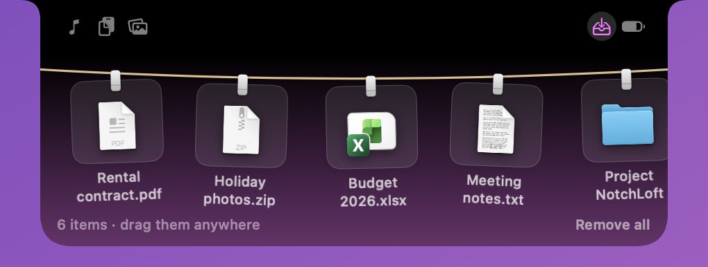
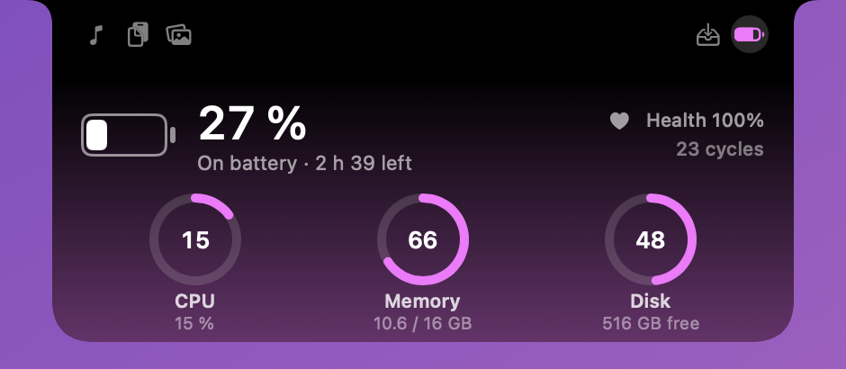

**English · [Français](README.fr.md)**

# NotchLoft

**The toolbox hidden in your MacBook's notch.**

Now playing, clipboard history, a screenshot shelf, a file tray, battery and system stats: hover the notch and everything is there.

 

Music

Screenshot shelf

Clipboard

File tray

Battery & system

 

Idle

## Features

### 🎵 Music
- Reads the system "Now Playing": Apple Music, Spotify, your browser…
- **Idle**, the notch widens just a little: artwork on the left (with a progress ring), animated visualizer on the right (the bars follow the sound, bass on the left and treble on the right), a pause symbol when paused. Nothing shows when nothing is playing.
- **On hover**: artwork, title and artist (scrolling when long), a progress bar you can click or drag, elapsed and remaining time, previous / play-pause / next. Click the source app's icon to open Spotify, Music…
- Accent colors taken from the artwork, or a fixed color of your choice.

### 📋 Clipboard
- History of copied text (30 items); one click puts an item back on the clipboard.
- Pin the important items: they stay, even after a restart.
- Passwords copied from password managers (1Password and others) are never recorded.

### 🧷 Screenshot shelf
- Your latest captures (up to 30) hang on a clothesline with clothespins. Scroll left or right to see the others.
- **Everything goes in**: screenshots, **screen recordings** (with their duration), and captures copied to the clipboard (⌃⇧⌘3 / ⌃⇧⌘4).
- **Animation**: each new capture flies to the notch, which opens for a moment to hang it up.
- Click to open, **drag and drop** into any app, a **cross** on hover to remove a capture from the shelf (the file stays untouched), right-click to copy, show in Finder or move to the Trash.

### 📥 File tray
- Drag a file or folder onto the notch: it opens by itself and the item hangs on the clothesline.
- Take it back later by dragging it into any app. Nothing is copied or moved: these are shortcuts to your files.
- Click to open, cross to remove, right-click to show in Finder or copy its path.

### 🔋 Battery & system
- Battery level, charging state, time remaining, health and cycles, plus CPU, memory and disk.
- **You choose what is shown large**: click a gauge to bring it forward (or use the ♪ menu). The CPU adds a live graph.

### And also
- **Tabs** in the notch's wings to switch between tools.
- **English or French**: the interface is in English by default; switch to French from the ♪ menu → Language.
- **Customizable** from the menu bar icon: page on open (a fixed page or the last used), enable or disable each tool, visualizer, progress ring, blurred background, haptic feedback, accent color, idle width, hide after a pause, launch at login, update checks.
- **Discreet**: no Dock icon, and the idle notch hides in full-screen apps (it still opens when you hover the notch). Adjustable in the ♪ menu.
- **For every Mac**: on a Mac without a notch, a simulated notch takes over.

## Installation

1. Download **NotchLoft.dmg** with the button above.
2. Open the DMG and drag **NotchLoft** into **Applications**.
3. On first launch, macOS shows a warning because the app is not notarized. Open **System Settings → Privacy & Security**, scroll down to NotchLoft and click **Open Anyway**.
4. For the shelf, allow access to the screenshots folder (Desktop by default) when macOS asks.

## Limitations

- The clipboard keeps text only, not images or files.
- The shelf can't see captures sent straight to an app (Mail, Messages…): they exist neither as a file nor on the clipboard.
- The visualizer follows the Mac's sound when you allow it (macOS 14.2 or later); without permission it stays a decorative animation. It can't see DRM-protected audio.
- The app is not notarized by Apple, hence the warning on first launch.
- Playback info depends on what the app reports to the system: some players send neither artwork nor duration.
- Personal use only, see the [license](LICENSE).
